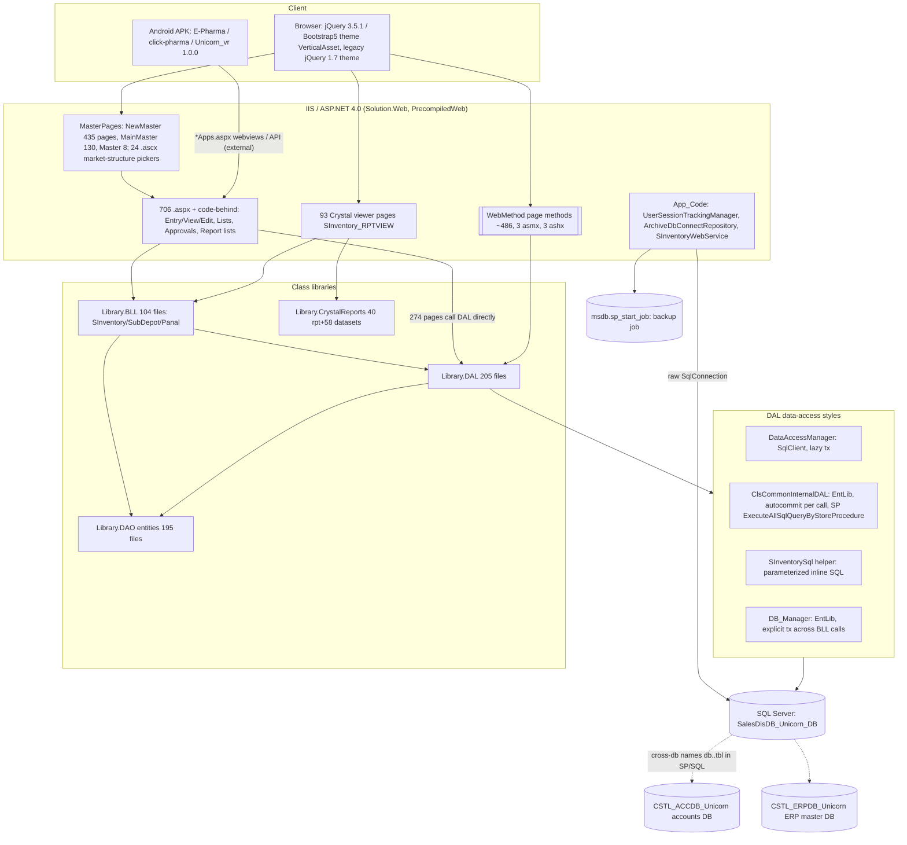

# Architecture (reverse-engineered)

Scope: cross-cutting technical architecture of the ASP.NET WebForms sales and distribution / pharma field-force ERP in this repository. Documentation only; every claim carries a path. Confidence tags: `CONFIRMED` (read in implementation), `INFERRED`, `UNKNOWN`. No credentials are reproduced (`<redacted>`).

Related: [security.md](security.md), [coding-standard.md](coding-standard.md), [testing.md](testing.md), [deployment.md](deployment.md), [reverse-engineering/system-inventory.md](reverse-engineering/system-inventory.md), [../specs/00-system/system-overview.md](../specs/00-system/system-overview.md).

## 1. Solution structure

| Item | Path | What it is | Evidence |
|---|---|---|---|
| Solution | `Solution.sln` | Visual Studio 2010 format (`Format Version 11.00`), 5 projects (1 website + 4 class libraries). Debug and Release website builds both map to `Debug\|Any CPU` | `Solution.sln:1-2`, `:31-40` |
| Website project | `Solution.Web/` | **Web Site project (no .csproj)** with `ProjectReferences` to Library.DAL.dll, Library.DAO.dll, Library.BLL.dll. Target `v4.0`. `AspNetCompiler.TargetPath = PrecompiledWeb\Solution.Web\`, `Updateable = true` | `Solution.sln:3-24` (CONFIRMED) |
| Library.BLL | `Library.BLL/Library.BLL.csproj` | Class library v4.0; refs DAL + DAO; 104 .cs, ~12.9k LOC. Folders `Panal_BLL`, `SInventory_BLL` (96 files), `SubDepot_BLL` | csproj, file count |
| Library.DAL | `Library.DAL/Library.DAL.csproj` | Class library v4.0; refs DAO; Enterprise Library 4.1 DLLs from `DLL/`; 205 .cs, ~69.4k LOC | csproj `HintPath ..\DLL\...` |
| Library.DAO | `Library.DAO/Library.DAO.csproj` | Entities / DTOs (195 .cs, ~6.3k LOC), no refs | csproj |
| Library.CrystalReports | `Library.CrystalReports/Library.CrystalReports.csproj` | 40 `.rpt` compiled with typed wrappers (`SInventory_RPT`), 58 typed DataSets (`SInventory_DS`, .xsd/.xsc/.xss + designer); ~103.7k LOC mostly generated. Refs CrystalDecisions 13.0.2000.0 from GAC (no HintPath) | csproj |
| `PrecompiledWeb/Solution.Web/` | build output of `aspnet_compiler` (3,015 files: `.compiled`, `App_Code.dll`, 184 files in `bin/`). Committed to git (2,830 tracked files under PrecompiledWeb/bin/obj) | `PrecompiledApp.config` = `version="2" updatable="true"` |
| `DLL/` | 3 Microsoft Enterprise Library 4.1 assemblies (Common, Data, ObjectBuilder2) referenced by hint path from Library.DAL | `Library.DAL.csproj` |
| `packages/` | NuGet restore folder (ClosedXML 0.95.4, EPPlus 4.1.0, Newtonsoft.Json 13.0.1, Newtonsoft.Json.Schema 3.0.14, DocumentFormat.OpenXml 2.7.2, MVC 4.0 / Razor 2.0 / WebPages 2.0, Bcl.*, JSON 1.0.1, OfficeOpenXml.Extends 1.0.6, System.Web.Http.Common 4.0). Ignored in `.gitignore` | `packages/repositories.config` |
| `MVC_TreeGrid_Template/` | **Stub, not part of the solution**: `Controllers/ReportController.cs` (uses `Microsoft.AspNetCore.Mvc` + `IConfiguration`, i.e. ASP.NET Core, incompatible with the .NET 4.0 build), `Models/CoverageReportModel.cs`, `Views/Report/ReportView.cshtml`. No .csproj, not referenced by any project. It calls the SP `sp_MIS_GetSalesmanCustomerVisitReport`, which the WebForms DAL also calls (`Library.DAL/DoctorVisit_DAL/DoctorVisitDAL.cs:222`) | CONFIRMED |
| Root SQL scripts | 17 `*.sql` (5,463 lines) | Hand-run live DB patches, see [deployment.md](deployment.md) | root dir |
| `Pro_Info/` | 9 business sample files (`Customer Ledger Report ... .xlsx`, `MarketTranferFormat (Market Shift).xls`, `d3.png`) committed to git | tracked files |
| `UpgradeLog.htm`, `_compilecheck.dll`, `CSC*.TMP` | VS migration report (website project not migratable in that VS install, 1 error; solution itself needs no migration); a stray compile-check artefact | `UpgradeLog.htm` |

Dependency direction (project references): `Solution.Web -> BLL -> DAL -> DAO`; `Solution.Web -> DAO`; `Solution.Web -> DAL` (directly, 274 code-behind files use `Library.DAL`, versus 429 that use `Library.BLL`). `Library.CrystalReports` is referenced by pages through `using Library.CrystalReports.*` (89 code-behind files) although it is **not** in the website `ProjectReferences` list (it is present as `Bin/Library.CrystalReports.dll`, so it is resolved from `Bin/`). BLL also references `System.Web` (uses `HttpContext.Current.Session`, e.g. `Library.BLL/SInventory_BLL/InvoiceBLL.cs:97`), and DAL uses `HttpContext.Current.Session` (`Library.DAL/DoctorModule_DAL/CommonDataLoad.cs:23`), so the layers are not UI-independent.

## 2. Runtime and framework versions

| Aspect | Value | Evidence |
|---|---|---|
| Framework | .NET Framework 4.0 (`targetFramework="4.0"`; all csproj `v4.0`; packages `net40`) | `Solution.Web/Web.config` `<compilation>`, csproj files |
| Language | C# (Web Site default `Visual C#`), also `Microsoft.VisualBasic` assembly listed | `Solution.sln` `DefaultWebSiteLanguage`, Web.config |
| IDE | Visual Studio 2010 (`# Visual Studio 2010`); `website.publishproj` `ToolsVersion=4.0`, `VisualStudioVersion 10.0` | sln, `Solution.Web/website.publishproj` |
| Pipeline | IIS integrated mode handlers + `runAllManagedModulesForAllRequests="true"`; Crystal image handler registered in both `httpHandlers` and `system.webServer/handlers` | Web.config |
| ASP.NET features | Forms auth mode, InProc session, Web Forms + UpdatePanel/ScriptManager, `[WebMethod]` page methods, 3 `.asmx`, 3 `.ashx`, URL routing (`RouteTable`, one route) | Web.config, `Global.asax` |
| Data provider | `System.Data.SqlClient` via hand-written `DataAccessManager`, plus Microsoft Enterprise Library 4.1 Data (`DatabaseFactory`), plus OleDb (Jet 4.0 / ACE 12.0) for `.xls/.xlsx` import | see section 5 |
| Key runtime libs in `Solution.Web/Bin/` (54 DLLs) | EPPlus **6.0.3** (`packages.config` lists 4.1.0: mismatch; Web.config binding redirect to 6.0.3.0), ClosedXML 0.95.4, DocumentFormat.OpenXml 2.7.2, BouncyCastle.Crypto 1.8.9, Newtonsoft.Json 13.0.1 (+ `Newtonsoft.Json.Schema`, `Newtonsoft.JsonResult`), AjaxControlToolkit 3.0.20820, DropDownCheckBoxes 1.1, `Json.dll` 1.0, CrystalDecisions 13.0.16.1954 (Web.config pins 13.0.2000.0), Enterprise Library 4.1 | file properties of `Solution.Web/Bin/*.dll` |
| log4net | Referenced only in `Web.config` `<compilation><assemblies>` (1.2.10.0). **No log4net.dll in the repository, no `ILog`/`LogManager` code, no log4net config section** | grep (0 code hits) CONFIRMED |
| Packages declared | `Solution.Web/packages.config` (17 packages) and each library's `packages.config` (only System.Web.Http.Common 4.0.20126.16343) | files |

## 3. Layered diagram



ASCII summary:

```
Browser / Android WebView
   |  HTTP (Forms-mode config, InProc Session, no <authorization>)
IIS  Solution.Web  [MasterPage -> Page .aspx.cs] [WebMethod/asmx/ashx] [Crystal viewer .aspx]
   |                     |  (429 pages)                |(274 pages direct)
Library.BLL  ------>  Library.DAL  --(SP + inline SQL, DataAccessManager / EntLib)--> SQL Server
        \____ Library.DAO (entities) ____/                                   |-- SalesDisDB_Unicorn_DB (main)
Library.CrystalReports (.rpt + typed datasets); viewers load Solution.Web/Reports/CrystalReports/*.rpt
```

## 4. Layer responsibilities (as actually implemented)

| Layer | Intended | Actually observed |
|---|---|---|
| Page (`.aspx.cs`) | UI events | Contains most business orchestration: loops over grid rows and calls several BLL/DAL methods (`Solution.Web/SInventory_UI/LoadingSummary.aspx.cs:602-660`), builds SQL filter fragments from control values (`Solution.Web/Approval_UI/CustomerApproveList.aspx.cs:459-505`), holds `static` DAL/BLL fields (366 occurrences), stores report parameters in `Session` (93 distinct session keys) |
| BLL | Rules | Thin pass-through in most classes, plus PK generation (`ClsPrimaryKeyFind.PrimaryKeyMax`, 150 call sites in 59 files), code/number generation (`InvoiceNoGenerator`, `AreaCodeGenerator`), simple existence checks. Exists only for 3 namespaces (`SInventory_BLL`, `SubDepot_BLL`, `Panal_BLL`). Doctor / HR / MasterSetup / Target / DWSP / Transfer pages have **no BLL** and call DAL directly |
| DAL | SQL | SP calls (about 1,023 distinct SP name literals) and inline SQL (parameterized via `SInventorySql`, or concatenated). Also contains business logic, session access and UI-control binding (`LoadDropDownValue(DropDownList ...)` in `ClsCommonInternalDAL`) |
| DAO | Entities | Plain property bags per module (`SInventory_Entities` 75, `DoctorModule_DAO` 80, ...). `ResultInfo` lives in `Library.DAO/SInventory_Entities/ResultInfo.cs` but namespace `SalesSolution.Web.Models` is used by several DALs |
| Database | Persistence | Most business logic (stock, posting, approval) lives in stored procedures whose bodies are **not in the repo** except ~41 in root scripts and `Library.DAL/SAP_IntegrationDAL/sql/` |

## 5. Traced examples (3 required + 3 extra)

### 5.1 Login (page -> BLL -> DAL -> inline SQL)

1. `Solution.Web/Login.aspx` (no master) `loginButton_Click` (`Login.aspx.cs:18`) trims both boxes, rejects empty ones with messages ("Input Use Name Please!!!", "Input Password Please!!!").
2. `PanalBLL.Login` (`Library.BLL/Panal_BLL/PanalBLL.cs:34-37`) is a pass-through to `PanalClsDAL.Login`.
3. `PanalClsDAL.Login` (`Library.DAL/PanalCls/PanalClsDAL.cs:15-52`) opens `DataAccessManager` on `DataBase.SalesDB`, runs an inline parameterized `SELECT TOP 1 ... FROM dbo.tblUser U ... WHERE LoginName=@LoginName AND Password=@Password AND UserStatus='active'` (joins `tblUserCompanyUnit`, `tblEmpGeneralInfo`, `tblDAInfo`, `tblDesignation`, `tbl_UserRoleInfo`, `tblRoleType`) via `GetDataTableByText`, and closes in `finally`. **The password is compared as clear text in SQL** (see [security.md](security.md)).
4. Back in the page: 1+ row => sets 17 Session keys (`Login.aspx.cs:34-69`), calls `UserSessionTrackingManager.StartTracking` (best-effort insert into `tblUserSessionTracking`), then redirects: `IsMainDashboard` true => `Dashboard_UI/AdminDashboard.aspx`; else `aspxerrorpath` query value if it does not start with `http` (`:99-113`); else `Dashboard_UI/DashboardOne.aspx`. No `FormsAuthentication` call exists anywhere in the repo, so the "Forms" auth cookie is never issued; **session state alone is the login state** (CONFIRMED by grep: 0 hits for `FormsAuthentication|SetAuthCookie|IsAuthenticated`).
5. Every subsequent page loads the master; `NewMasterPage.master.cs:15-63` checks `Session["UserId"] != null` on first GET only (inside `!IsPostBack`), otherwise redirects to `../Login.aspx`, and builds the menu with `dbo.MainMenu2(@UserId,@UserRoleID)` (`Library.DAL/SInventory_DAL/UserDAL.cs:33-40`).

### 5.2 BLL -> DAL -> SP save: delivery confirmation (order-to-cash step) and a transactional master save

A. `Solution.Web/SInventory_UI/LoadingSummary.aspx.cs:602-660` (`btnFinalSubmit_Click`) loops grid rows; for a checked row with status "Full Dues" it calls, one after the other:
   - `InvoiceBLL.SaveFullInvoice` (`Library.BLL/SInventory_BLL/InvoiceBLL.cs:37`) -> `InvoiceDAL.SaveFullInvoice` (`Library.DAL/SInventory_DAL/InvoiceDAL.cs:213-220`) -> `ClsCommonInternalDAL.RunStoreProcedure("sp_DeliveryConformationFull_New", ..., "SSIDB")` (EntLib, own connection).
   - `UP_LoadingSummaryInvoice` (`InvoiceDAL.cs:242-249`) -> SP `sp_UP_LoadingSummary`.
   - `PostDeliveryConfFullJournal` (`InvoiceDAL.cs:222-230`) -> `UpdateAction("sp_Sales_DeliverySalesPosting")` (journal posting into the accounts DB, per root audit script `SP_Audit_Sales_Accounts_Voucher_Posting.sql` which cross-references `CSTL_ACCDB_Unicorn`).
   Each call is a separate auto-committed connection, **there is no wrapping transaction**, and the returned `status` values are overwritten and never checked (`:622-631`). SP bodies are not in the repo (`UNKNOWN`), so atomicity inside the SPs is unverified.

B. `Solution.Web/DoctorMaster_UI/ChamberType.aspx.cs` -> `DoctorCategoryDal.SaveDoctorCategory` (`Library.DAL/DoctorMaster_DAL/DoctorCategoryDal.cs:15-70`): `SqlConnectionOpen(DataBase.SalesDB)`; if `CategoryId > 0` calls `sp_check_DoctorCategory` then `UpdateData("sp_Update_DoctorCategory")` else `SaveDataReturnPrimaryKey("sp_Save_DoctorCategory")` (SP must SELECT the new key; read with `ExecuteScalar`); on exception `SqlConnectionClose(true)` (rollback) then rethrow; `finally` `SqlConnectionClose()` (commit). This is the canonical DataAccessManager write pattern.

C. Master data via inline SQL with MAX+1 key: `AreaEntry.aspx.cs:submitButton_Click1` -> `AreaBLL.SaveArea` (`Library.BLL/SInventory_BLL/AreaBLL.cs:15-40`) -> `HasAreaName` (checks `AreaCode`) -> `ClsPrimaryKeyFind.PrimaryKeyMax("AreaId","tblArea")` -> `AreaDAL.SaveAreaInfo` (`Library.DAL/SInventory_DAL/AreaDAL.cs:16-26`, parameterized INSERT via `SInventorySql.Execute` -> `ClsCommonInternalDAL.UpdateDataByUpdateCommandNew`).

### 5.3 Inline-SQL DAL and direct-DAL page

`Solution.Web/Approval_UI/CustomerApproveList.aspx.cs` uses `private static CustomerInfoDAL _DAL` (`:22`) with no BLL. It assembles a filter string `pram` by concatenating dropdown `SelectedValue`s (`:459-505`), then `CustomerInfoDAL.GetCustomer_ApplogDAL` (`Library.DAL/MasterSetup_DAL/CustomerInfoDAL.cs:785-815`) passes the string as a `@param` parameter to SP `sp_Get_CustomerApp`. The SP body is not in the repo; passing a WHERE-fragment as a parameter implies dynamic SQL inside the SP (`INFERRED`). The same page implements its own permission check (`UserPersmissionValidation`, `:80-105`, role id `2` bypasses it).

### 5.4 Crystal Reports viewer

`Solution.Web/SInventory_RPTVIEW/ChallanReportViewer.aspx` (no master, no session check) `Page_Init` (`.cs:16-38`): reads `Request.QueryString["reqId"]`; `StockTransportOrderReportBLL` -> `StockTransportOrderReportDAL.StockTransportOrderReportMainData` (`Library.DAL/SInventory_DAL/StockTransportOrderReportDAL.cs:19-28`, parameterized inline SQL over `tblRequisition`/`tblWearhouse`/`tblCompanyUnit`), `...DetailData`, `CompanyInformation`; builds a `DataSet` with tables `mainDataTable`, `detailDataTable`, `companyInfoDataTable`; `ReportDocument.Load(Server.MapPath("~\Reports\CrystalReports\crpChallan.rpt"))`, `SetDataSource(ds)`, binds `CrystalReportViewer`. Disposal in `Unload`/`Disposed`. The alternative style (typed wrapper `new rptStockTransfarOrder()` from `Library.CrystalReports.SInventory_RPT`) is commented out on the same page. See section 9.

### 5.5 `[WebMethod]` page method

`Solution.Web/Dashboard_UI/AdminDashboard.aspx.cs:18` `static ChartDAL aChartDal = new ChartDAL();`; `[WebMethod] public static string Get_DeptoWiseOrder(string param)` (`:134-142`) calls `ChartDAL.GetDeptoWiseOrderDAL(param)` (`Library.DAL/ChartDAL/ChartDAL.cs:559-573`; chooses SP `sp_Get_DashboardOrder_DeptoWise` or `sp_Get_DashboardDeptoWiseOrder`), and returns `JsonConvert.SerializeObject(DataTable)`. Client: `$.ajax` to `AdminDashboard.aspx/Get_DeptoWiseOrder` (`AdminDashboard.aspx:3071`). Count: 486 `[WebMethod]` attributes (84 with `EnableSession=true`, 402 without) in 119 files; 23 in `App_Code/SInventoryWebService.cs`. Page methods bypass master pages (no master `Page_Load` check runs), so they rely on the method body for authorization (none observed).

## 6. Data access internals

### 6.1 `DataAccessManager` (`Library.DAL/DataManager/DataAccessManager.cs`, 600 lines) - the primary manager (used in 76 DAL files)

| Aspect | Behaviour (CONFIRMED) |
|---|---|
| Instance state | Fields `sqlConnection`, `sqlTransaction`, `sqlDataReader` (`:14-16`). **Not thread-safe**; each DAL class normally owns one instance, but pages hold DAL/BLL objects in `static` fields (366 sites, e.g. `DoctorMaster_UI/ChamberType.aspx.cs:13`, `Dashboard_UI/AdminDashboard.aspx.cs:18`), so one manager (one connection/transaction) can be shared by concurrent requests (`INFERRED` hazard) |
| Connection string | Built per call: source/user/password from `SqlUserAccess` static fields + `Encrypt=True;TrustServerCertificate=True` (`:22-32`). Independent of `Web.config` |
| Open | `SqlConnectionOpen(db)` -> `EnsureOpen` (`:35-61`): re-creates the connection if the target DB string changed, closes Broken, opens; **does not begin a transaction** |
| Reads | `GetDataTable / GetDataSet / GetDataTableByText / GetSqlDataReader` overloads with optional `List<SqlParameter>`, `isBigData`, `database`. Default `CommandTimeout` = **8000 s** (`:17`); `isBigData` => `Math.Max(8000,600)` = 8000 (no effect). Reads join the active transaction when one exists |
| Writes | `SaveData / UpdateData / DeleteData / SaveDataReturnPrimaryKey / ExecuteNonQueryByText` call `ExecuteNonQueryVoid/ScalarInt/...ByText` (`:407-472`) which **lazily `BeginTransaction()` on the first write** and reuse it. `SaveDataReturnPrimaryKey` = `ExecuteScalar` -> `SafeScalarToInt` (0 for null) |
| Close | `SqlConnectionClose(isRollBack=false)` (`:122-170`): closes reader, **commits (default) or rolls back** the transaction, closes and disposes the connection. Callers must invoke it in `finally`; commit-on-close means "forgot to roll back" = commit |
| Latent defect | In both `GetSqlDataReader` overloads the object initializer (`CommandType = StoredProcedure`, timeout) is attached only to the *else* branch of the `? :` (`:183-189`, `:213-219`); when a transaction is active the command is created as `CommandType.Text` with the default 30 s timeout (`INFERRED` consequence: mis-executed procedure calls) |
| Exceptions | Only `SqlException` is caught to set `isException` and rethrown (`throw;`) |

### 6.2 `DataAccessManagerAsync.cs` (349 lines) and `DataAccessManagerOld.cs` (535 lines)

Older variants: transaction begins **immediately on open**, always commit/rollback on close, no `Encrypt` in the connection string (Old adds `MultipleActiveResultSets=True`), `CommandTimeout` 199,000,000 (Old, per command) / 120,000 (Async big data), Async wraps `SqlDataAdapter.Fill` in `Task.Run`. **No live usage**: the only reference is a commented line (`Library.DAL/DoctorModule_DAL/ZoneSetupDAL.cs:17`). Dead code.

### 6.3 `ClsCommonInternalDAL` (`Library.DAL/InternalCls/ClsCommonInternalDAL.cs`, 709 lines; used by 119 DAL files)

- Uses **Enterprise Library** `DatabaseFactory.CreateDatabase("SolutionConnectionString" + dataBaseName)`; callers pass `"SSIDB"` (754 literal uses) so the only resolvable name is `SolutionConnectionStringSSIDB` in Web.config. One connection string, one database (`SalesDisDB_Unicorn_DB`).
- **Every call is its own auto-committed round-trip** (no transaction, pooled connection).
- Text-query methods (`DataContainerDataTable(query,...)`, `DataContainerDataReader`, `SaveDataByInsertCommand(query)`, `UpdateDataByUpdateCommand(query)`, `DeleteDataByDeleteCommand(query)`, `LoadDropDownValue*`) send the SQL string as the `@Query` parameter of a **database stored procedure `ExecuteAllSqlQueryByStoreProcedure`** (12 references; body not in repo, presumably `EXEC(@Query)`), so any concatenated SQL runs as a raw batch. The `...(query, List<SqlParameter>, ...)` overloads use `GetSqlStringCommand` with real parameters. Timeouts are inconsistent: 60/90 s in newer methods, 99,000,000 s in older ones.
- `UpdateDataByUpdateCommand(query, dbName)` swallows exceptions and returns `false` (`:487-491`); `SaveAction(...)` swallows and returns 0 (`:599-603`); others rethrow (`throw ex;` loses stack).
- Returns `IDataReader` from `DataContainerDataReader` (caller must dispose; comment at `:107`).

### 6.4 `SInventorySql` (`Library.DAL/SInventory_DAL/SInventorySql.cs`, 84 DAL files)

Internal static helper adopted for parameterized inline SQL: `GetDataTable` uses `DataAccessManager` on `DataBase.SalesDB` (open/close per call), `Exists`, and `Execute` -> `ClsCommonInternalDAL.UpdateDataByUpdateCommandNew` (parameterized, EntLib). Evidence of an in-progress hardening: old concatenated versions remain as comments (e.g. `StockTransportOrderReportDAL.cs:30-41`).

### 6.5 `DB_Manager` (`Library.DAL/MAIN_FUNCTION/DB_Manager.cs`, 308 lines; 8 DAL files)

EntLib `SqlDatabase(DB_Connection.GenerateString(name))`; `CreateConnection(db)` opens the connection and **starts a transaction immediately**; `CloseConnection()` **commits** (no rollback path exposed). Because it is exposed as `CreateConnection_DAL()/CloseAllConnection_DAL()` and driven from BLL (`InvoiceBLL.cs:27-35`, `ReturnInvoiceBLL.cs:76`, `SalesReturnBLL.cs:29`, `Sub_InvoiceBLL.cs:22`), a BLL object can hold an open transaction across several calls. `ExecuteNonQueryAction` catches all exceptions, rolls back, closes the connection and returns `0`; `Save/Update/DeleteAction` swallow further errors and return `false`. Command timeout 12,000,000 s. Connection target: `DB_Authentication` static host/user (a second, independent copy of connection settings, `Library.DAL/MAIN_FUNCTION/DB_Authentication.cs`). **All five callers pass a hard-coded database name `SalesDisDB_New3`** (`InvoiceDAL.cs:207`, `MaterialConversionReceiveDal.cs:17`, `ReturnInvoiceDAL.cs:78`, `SalesReturnDAL.cs:244`, `Sub_InvoiceDAL.cs:20`), which differs from `DataBase.SalesDB` (`SalesDisDB_Unicorn_DB`): whether that database exists on the live server is `UNKNOWN`; the visible `aDbManager.Save/Update` uses in `InvoiceDAL` are commented out.

### 6.6 Direct `SqlConnection` (6 files)

`App_Code/ArchiveDbConnectRepository.cs`, `App_Code/UserSessionTrackingManager.cs` (parameterized, read the Web.config connection string), and 4 report pages (`SInventory_UI/BatchLifecycleReport.aspx.cs`, `CustomerPaymentReport.aspx.cs`, `CustomerPaymentReportPDF.aspx.cs`, `MoneyReceiptPreview.aspx.cs`). Two DAL files also build connection strings directly (`ProductUnitPriceDAL.cs:226`, `SalesOperationRollbackDAL.cs:18`, both with `Encrypt=True;TrustServerCertificate=True`).

### 6.7 `EncryptDecrypt` (`Library.DAL/DataManager/EncryptDecrypt.cs`)

Rijndael-256 CBC via `PasswordDeriveBytes` (SHA1, 2 iterations) with **hard-coded passphrase, salt and IV** in the source. It has **no callers** anywhere in the repo (grep: only its own definition) - dead code, and it is not used for passwords. See [security.md](security.md).

### 6.8 `ClsPrimaryKeyFind` (primary keys)

`PrimaryKeyMax(column, table[, db])` runs `SELECT (isnull(MAX(col),0)+1) as PKMaxNo FROM <table>` by string concatenation through `DataContainerDataTable` (`Library.DAL/InternalCls/ClsPrimaryKeyFind.cs:11-46`), i.e. **PKs are `MAX+1`, computed in application code, not identity or sequence** (150 call sites in 59 files; e.g. `AreaBLL.cs:24`, `InvoiceBLL.cs:88`, `:110`, `:119`, `:124`). Not atomic: two concurrent saves can compute the same key (`INFERRED` race; the table PK constraint would reject one - `UNKNOWN`). A third overload `PrimaryKeyMax(table)` reads `IDENT_CURRENT('<table>')`. Other tables use SP-generated identity returned via `SaveDataReturnPrimaryKey` / `SCOPE_IDENTITY()` (`ClsCommonInternalDAL.SaveDataByInsertCommandWithIdentity`, `:148-175`; `DoctorCategoryDal.cs`).

### 6.9 `ClsApprovalAction`

`LoadActionControlByUser(RadioButtonList, pageName, userName)` and `LoadForApprovalByUserCondition` (`Library.DAL/InternalCls/ClsApprovalAction.cs`) query `tblActionUserWiseApproval`, `tblActionPageWiseStep`, `tblActionSteps`, `tblActionStepDetail`, `tblMainMenu`, `tblAction` with **concatenated `userName` and `pageName`** (`:17-19`, `:71-73`), database `"SSIDB"`. Approval action radio items are enabled/disabled by the DB-defined step for the login name and page URL. This is the approval-step engine used by older approval pages (M18).

### 6.10 `DataBase.cs`, `SqlUserAccess.cs`

`DataBase.SalesDB` (constant, main database, 1,075 uses); `SqlUserAccess` holds static `DataSource`, `UserName`, `PassWord` (live values are hard-coded `sa` credentials; about 14 commented alternates including a lower-privileged web login and several other hosts), a `LiveServer=false` flag with **no readers**, and unused REST constants (`BASE_URL`, `AppName`). Connection settings therefore exist in **four places** that must be edited in step: `Solution.Web/Web.config`, `SqlUserAccess.cs`, `DB_Authentication.cs`, `DataBase.cs` (database name).

## 7. Multiple-database access

| Database | How reached | Evidence |
|---|---|---|
| `SalesDisDB_Unicorn_DB` (main) | `DataBase.SalesDB`; Web.config `SolutionConnectionStringSSIDB` (Initial Catalog) | `DataBase.cs:7`, Web.config |
| Alias "SSIDB" | Not a database: suffix appended to `SolutionConnectionString` for EntLib | `ClsCommonInternalDAL.cs:95` |
| `CSTL_ACCDB_Unicorn` (accounts) | Cross-database names inside SQL/SP text, e.g. `CSTL_ACCDB_Unicorn..tblDebitCreditVoucherMaster` (19 code hits) and root script `SP_Audit_Sales_Accounts_Voucher_Posting.sql` | grep |
| `CSTL_ERPDB_Unicorn` (ERP master, material conversion, batch stock) | Cross-db names `CSTL_ERPDB_Unicorn..tbl_MC_MaterialConversionMaster`, `..tbl_INV_BatchWiseStock` (17 hits) | grep |
| Legacy `SalesDisDB_SMC_NEWDB` | 1 cross-db query `SalesDisDB_SMC_NEWDB..tblFinancialYear` in `PanalClsDAL.FinancialYearList` (`PanalClsDAL.cs:66`); other legacy names only in comments (`DataBase.cs`) | grep |
| `SalesDisDB_New3` | `DB_Manager` connections (section 6.5) | 5 files |
| Archive databases (per financial year) | `SettingPanel_UI/ArchiveDbConnect.aspx` -> `App_Code/ArchiveDbConnectRepository.cs`: inserts `(FY, DataBaseName)` into `dbo.tblArcDBConnect`, then `EXEC msdb.dbo.sp_start_job @job_name` (default job name `Society_DB_Backup_Job`, overridable by app settings `DatabaseBackupJobName` / `DatabaseBackupConnectionStringName`, neither defined in Web.config so defaults apply). Archive-side data deletion: `Library.DAL/DoctorModule_DAL/FinancialYearDeleteTableDAL.cs` calls SPs `sp_DeleteArchiveDB*Data` on `DataBase.SalesDB` with a target `databaseName` parameter, and `sp_DeleteArchive*Data` (delete after archive). SP bodies UNKNOWN | files |
| Session tracking DB | same main DB, `dbo.tblUserSessionTracking` | `UserSessionTrackingManager.cs` |

No multi-tenant switching exists: all pages hit one database; "company unit" (`ComUnitId`) is a data filter in Session, not a database switch.

## 8. Master pages and user controls

| Master | Pages using it | Character |
|---|---|---|
| `MasterPages/NewMasterPage.master` (1,600+ lines) | 435 | Current theme: Bootstrap 5 "Vertical" admin template (`VerticalAsset/`), jQuery 3.5.1, DB-built menu (`dbo.MainMenu2`), user/designation header, forced password-change modal, ScriptManager. Session gate in `NewMasterPage.master.cs:15-63` |
| `MasterPages/MainMasterPage.master` | 130 | Older theme (`css/style.css`, `scripts/` jQuery 1.7/UI 1.8, an `http://` html5shim, jQuery 3.5.1 from a CDN). Builds a 3-level menu from `tblMainMenu` + `tblMenuDistribution` (`PanalDAL`); **UserId 1 sees the full menu** (`MainMasterPage.master.cs:49`); gate `Session["UserId"] == null || == ""` (`:20`) |
| `MasterPages/MasterPage.master` | 8 | Oldest, most session code commented out |
| No master | 133 (92 of 93 report viewers, `Login.aspx`, 41 others: `*Edit.aspx` popups, `*Apps.aspx` mobile webviews, `MoneyReceiptPreview`, ...) | Not covered by any master check |

24 user controls (`.ascx`), all "IV market structure" cascading pickers (group/zone/area/territory/sub-territory/market dropdowns), e.g. `MasterSetup_UI/IVMarketStructure.ascx`, used through `FindControl("GroupSelect")` (`CustomerApproveList.aspx.cs:24-30`). `CommonUI/TemplatePage.aspx` is the page template stub. Add new page = copy an existing trio (see [coding-standard.md](coding-standard.md)).

## 9. Crystal Reports pipeline

1. **Design**: 112 `.rpt` files: 72 in `Solution.Web/Reports/CrystalReports/` (loaded at runtime by path) and 40 in `Library.CrystalReports/SInventory_RPT/` (compiled into `Library.CrystalReports.dll` with generated wrapper classes `rptXxx`). 58 typed DataSets in `Library.CrystalReports/SInventory_DS/` (`ds*.xsd`).
2. **List page** (`SInventory_UI/*Report.aspx`, `Reports_UI/`): collects filters, redirects/opens the viewer with QueryString (`fromDate` 41 uses, `toDate` 38, `InvNo`, `districtId`, `rptType`, `reqId`, `comUnitId` ...) and/or `Session` (`Session["ReportView"]`, `["Excel"]`, `["SalesReport"]`, `["InvoiceId"]`, ...).
3. **Viewer page** (`SInventory_RPTVIEW/*Viewer.aspx`, 93 pages; `CrystalReportViewer` control in 93 aspx): `Page_Init` reads parameters, calls BLL/DAL for `DataTable`s, names tables to match the .rpt, `ReportDocument.Load(Server.MapPath("~\Reports\CrystalReports\x.rpt"))` (72 files), `SetDataSource(DataSet)`, binds viewer; explicit `Close/Dispose` in `Unload`. `ExportToStream/ExportToHttpResponse/ExportToDisk` appear 137 times for PDF/Excel export.
4. **Runtime**: `Web.config` maps `CrystalImageHandler.aspx` (GET) and sets `crystalReportViewer ResourceUri=../crystalreportviewers13`; CrystalImageCleaner app settings (auto-start, sleep 60,000, age 120,000). Viewer static resources are committed under `Solution.Web/crystalreportviewers13/` (with ActiveX print `.cab` files). `Solution.Web/Reports/CrystalReports/TempPE/` holds 72 build artefacts. Runtime must be SAP Crystal Reports for .NET 13 (CRforVS SP16, 13.0.16.1954 in `Bin/`).
5. **Excel exports** for non-Crystal reports: EPPlus (`using OfficeOpenXml`, 8 pages, e.g. `SInventory_UI/DynamicSalesReport.aspx.cs`) and ClosedXML (18 files, `XLWorkbook` in 11) writing to `MemoryStream` + `Response` (192 `Response.AddHeader`/`Content-Disposition` hits). **Excel import** uses OleDb (Jet 4.0 for `.xls`, ACE 12.0 for `.xlsx`) after saving the upload to `~/ExcelFiles/` (15 pages, e.g. `SInventory_UI/CustomerExcelUpload.aspx.cs:262-282`).

## 10. Session usage

`sessionState mode="InProc" timeout="24000"` minutes (= 400 hours, `Web.config`), cookies not cookieless. 93 distinct `Session["..."]` keys. Identity keys are set once in `Login.aspx.cs:34-69` (UserId, UserRoleID, RoleTypeId, RoleTypeName, LoginName, UserType, CentralWareHouse, ComUnitId, UserTime, EmpInfoId, EmpName, EmpMasterCode, DesigName, DICCompanyUnitId, IsPasswordChange, DICUnitId). Top usage: `UserId` (475), `LoginName` (172), `RoleTypeId` (96), `RoleTypeName` (95), `Excel` (90), `EmpInfoId` (79), `ProformaReport` (70), `UserType` (57), `MarketId` (45), `ComUnitId` (43). Session is also used as a **temp-storage / parameter bus** between list and viewer pages, and `SInventoryWebService` reads `Session["MOParam"]` (a SQL fragment) and appends it to a query (`App_Code/SInventoryWebService.cs:33-60`). `PictureHandler.ashx` / `SignatureHandler.ashx` serve JPEG bytes from `Session["ImageBytes"]` (note: `SignatureHandler` tests `ImageBytes` but writes `SigImageBytes`, `SignatureHandler.ashx:11-13`). InProc means all sessions are lost on app-pool recycle/deploy and the site cannot be load-balanced without sticky sessions/state server.

## 11. Excel / EPPlus / BouncyCastle / log4net usage

| Library | Actual use |
|---|---|
| EPPlus 6.0.3 | 8 report pages generate `.xlsx` (`using OfficeOpenXml`) |
| ClosedXML 0.95.4 (+ DocumentFormat.OpenXml 2.7.2) | 18 files, `XLWorkbook` in 11 |
| OleDb Jet/ACE | 15 upload pages read `.xls/.xlsx` |
| BouncyCastle.Crypto 1.8.9 | `using` directives only: `DoctorModule_UI/UserSetup.aspx.cs:5` (`Org.BouncyCastle.Crypto.Engines`), `Login.aspx.cs:2` (`Org.BouncyCastle.Asn1.X509`, unused) - no crypto calls found; effectively an unused reference |
| log4net | Web.config assembly entry only (no DLL, no code) |
| Newtonsoft.Json | 98 files (page methods returning `JsonConvert.SerializeObject(DataTable)`) |
| `JavaScriptSerializer` | 2 files (`HandlerDocCV.ashx`, `UserSessionTrackingManager.cs`) |
| Outbound HTTP | `UserSessionTrackingManager.ResolveLocation` calls `https://ipapi.co/<ip>/json/` (3 s timeout) for non-private client IPs at login; other `HttpClient/HttpWebRequest` hits are commented out (`DoctorModule_UI/Setup.aspx.cs:29`, `SInventory_UI/BankDepositSAP.aspx.cs`) |

## 12. Background services / jobs

**None in the application.** Verified: no `Timer`, `Thread`, `Task.Run` (except in the unused `DataAccessManagerAsync.cs:201`), `ThreadPool`, `BackgroundWorker`, `IHostedService`, Quartz or scheduled-task code in Library.* or Solution.Web (grep). `Solution.Web/Global.asax` only has `Application_Start` -> `RegisterRoutes` (single route `user-records` -> `~/DoctorModule_UI/UserRecords.aspx`). Two other `Global.asax` files (`Solution.Web/SInventory_UI/Global.asax`, `Solution.Web/SubDepot_UI/Global.asax`, identical VS templates with empty `Application_Start/End/Error`, `Session_Start/End`) sit in sub-folders where ASP.NET ignores them, so **`Application_Error` is empty and inactive**. The only scheduled work is external: SQL Server Agent job started on demand from `ArchiveDbConnect.aspx` (`msdb.dbo.sp_start_job`), and CrystalImageCleaner (built-in). Mobile-app data sync is performed by an external client calling WebMethods/pages (`M17` in specs); the REST base-URL constants in `SqlUserAccess.cs` have no consumers.

## 13. Logging and error handling

| Aspect | State |
|---|---|
| Central logging | None (no log4net usage, no `Trace`, no event log). One legacy `tblLoginLog` insert exists in `PanalClsDAL.LoginLog` but its only call is commented out (`Login.aspx.cs:46`) |
| Audit | `tblUserSessionTracking` (login time, IP, browser, OS, device, city via ipapi.co); `UpdateBy/UpdateDate/EntryBy` columns passed to SPs. `TouchCurrentSession` and `MarkCurrentSessionLoggedOut` are **never called**, so activity/logout are not recorded (`IsActiveSession` stays 1 until another login closes by SessionId) - CONFIRMED by grep (only `StartTracking` is called) |
| `Application_Error` | Empty and in an ignored file (section 12) |
| `customErrors` | Absent in Web.config => ASP.NET default `RemoteOnly` (remote users get the generic error page; local users get the detailed page). `compilation debug="true"`, `httpRuntime executionTimeout=36000` |
| Pattern in code | 1,228 `try` blocks in code-behind; about 609 empty `catch {}`; 507 `throw ex;` (stack loss) versus 620 bare `throw;` in DAL/BLL; several DAL/`DB_Manager` methods return `false`/`0` on any failure so the UI reports "not saved" without a reason; some pages surface `exception.Message` to the user (`SettingPanel_UI/ArchiveDbConnect.aspx.cs` `ShowFailure`) |

## 14. Configuration (Web.config keys; values redacted)

| Key / section | Value / meaning |
|---|---|
| `connectionStrings/SolutionConnectionStringSSIDB` | one live entry: SQL login `sa` with password `<redacted>`, catalog = main DB; 14 commented alternates (other hosts and passwords) `<redacted>` |
| `appSettings` | `CrystalImageCleaner-AutoStart=true`, `-Sleep=60000`, `-Age=120000`, `UnobtrusiveJavaScriptEnabled=true`. Optional keys read in code but absent: `DatabaseBackupConnectionStringName`, `DatabaseBackupJobName` |
| `authentication` | `mode="Forms"`, `loginUrl="~/Login.aspx"`, `timeout=2880` (min). No `<authorization>` and no `<location>` rules |
| `sessionState` | InProc, `timeout=24000`, cookieless false |
| `httpRuntime` | `executionTimeout=36000`, `maxRequestLength=4194303` (KB, ~4 GB), `maxUrlLength=131072`, `requestPathInvalidCharacters=""`, `requestValidationMode="2.0"` |
| `system.webServer` | `maxAllowedContentLength=4294967295`, `.apk` MIME map, `runAllManagedModulesForAllRequests=true` |
| `system.web.extensions` | `jsonSerialization maxJsonLength=50000000` |
| `membership/profile/roleManager` | Default SQL providers declared with `connectionStringName="ApplicationServices"`, which is **not defined**; roleManager disabled; unused |
| `businessObjects/crystalReports` | rptBuildProvider `embedRptInResource=true`, viewer `ResourceUri=../crystalreportviewers13` |
| `runtime/assemblyBinding` | redirects for Newtonsoft.Json (13.0.0.0), System.Runtime / System.Threading.Tasks (2.6.8.0), EPPlus (6.0.3.0) |
| Not present | `customErrors`, `httpCookies`/`requireSSL`, `machineKey`, `trace`, transforms (`Web.Debug/Release.config` do not exist) |

`Web.config` is git-ignored (`.gitignore` "Contains DB credentials") and not tracked, while the identical secrets also live in the tracked `Library.DAL/DataManager/SqlUserAccess.cs` and `Library.DAL/MAIN_FUNCTION/DB_Authentication.cs`. `PrecompiledWeb/Solution.Web/Web.config` differs from `Solution.Web/Web.config` only in which connection string entry is active (it targets a developer workstation host) - evidence that environments are switched by hand-editing.

## 15. `UserSessionTrackingManager` (`Solution.Web/App_Code/UserSessionTrackingManager.cs`)

Static class. `StartTracking(HttpContext)` (called once from `Login.aspx.cs:48`): reads `Session["UserId"]`, derives client IP by scanning `X-Forwarded-For`, `X-Real-IP`, `CF-Connecting-IP`, `Client-IP`, `REMOTE_ADDR`, `UserHostAddress` (first public address wins, so client-supplied headers are trusted), resolves country/region/city with an outbound call to ipapi.co (private/loopback IPs are labelled "Private Network"/"Local"), parses browser/OS/device from User-Agent, closes any active record with the same SessionId, and inserts into `dbo.tblUserSessionTracking` (columns UserId, LoginDateTime, LogoutDateTime, IPAddress, Country, RegionState, City, BrowserName, OSName, DeviceType, SessionId, LastActivityTime, IsActiveSession). All parameterized; all exceptions swallowed ("Audit logging should not break the login flow"). `TouchCurrentSession` and `MarkCurrentSessionLoggedOut` exist but have no callers. The viewing page is `Solution.Web/UserTracking/` (1 page).

## 16. Deployment architecture (inferred; see [deployment.md](deployment.md))

- Windows Server + IIS 7.5+ hosting the website (VS `SourceWebMetabasePath /IISExpress/7.5/...`; integrated pipeline handlers), site published either as source (Web Site) or as `PrecompiledWeb/Solution.Web` (updatable precompiled).
- One SQL Server named instance reachable over a private LAN from the web server (target in Web.config/`SqlUserAccess.cs`, `<redacted>`), holding `SalesDisDB_Unicorn_DB`, plus sibling databases `CSTL_ACCDB_Unicorn` and `CSTL_ERPDB_Unicorn` on the same instance (cross-db names without linked servers), and a SQL Agent backup job.
- Android clients: three APKs are served as static downloads from `Solution.Web/APK_File/` (`.apk` MIME mapping in Web.config); the login page links `Unicorn_vr(1.0.0).apk` (`Login.aspx:314`). The apps consume `*Apps.aspx` pages (no master, `EmpId`/`EmpInfoId` QueryString) and WebMethods; the external mobile API host referenced in `SqlUserAccess` has no code consumers.
- Uploaded content is written into the web root: `~/ExcelFiles/` (45 files present), `~/UploadFile/` (33 product images), `PrescriptionImages/` (9 committed image files; writer is not in this repo, `UNKNOWN`).
- Crystal Reports runtime + Jet/ACE OLEDB provider must exist on the server.

## 17. Architectural anomalies (summary)

1. Auth is session-only; Forms auth is configured but never issued and no authorization rules exist ([security.md](security.md)).
2. Four overlapping data-access stacks (DataAccessManager, EntLib `ClsCommonInternalDAL`, `SInventorySql`, `DB_Manager`) with different transaction semantics; two dead managers (`Old`, `Async`).
3. `MAX+1` primary keys in application code (150 sites).
4. Generic SQL-text executor SP (`ExecuteAllSqlQueryByStoreProcedure`) used by the ADO layer.
5. 366 static DAL/BLL fields on pages sharing non-thread-safe managers.
6. Business flow split across multiple autocommit calls in page loops (no atomicity in code).
7. Connection settings duplicated in 4 files; DB name `SalesDisDB_New3` hard-coded for `DB_Manager` paths.
8. 59 `.exclude` files (disabled pages kept in tree), `Copy of ...`/`_old` pages, build output and sample data committed to git.
9. `Application_Error` empty and placed in a folder-level Global.asax that IIS ignores; log4net referenced but absent.
10. `MVC_TreeGrid_Template` is an orphan ASP.NET Core stub.
